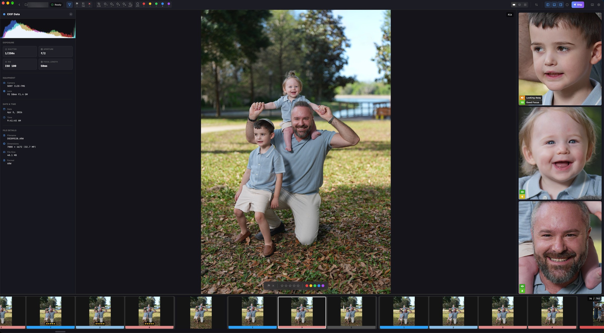
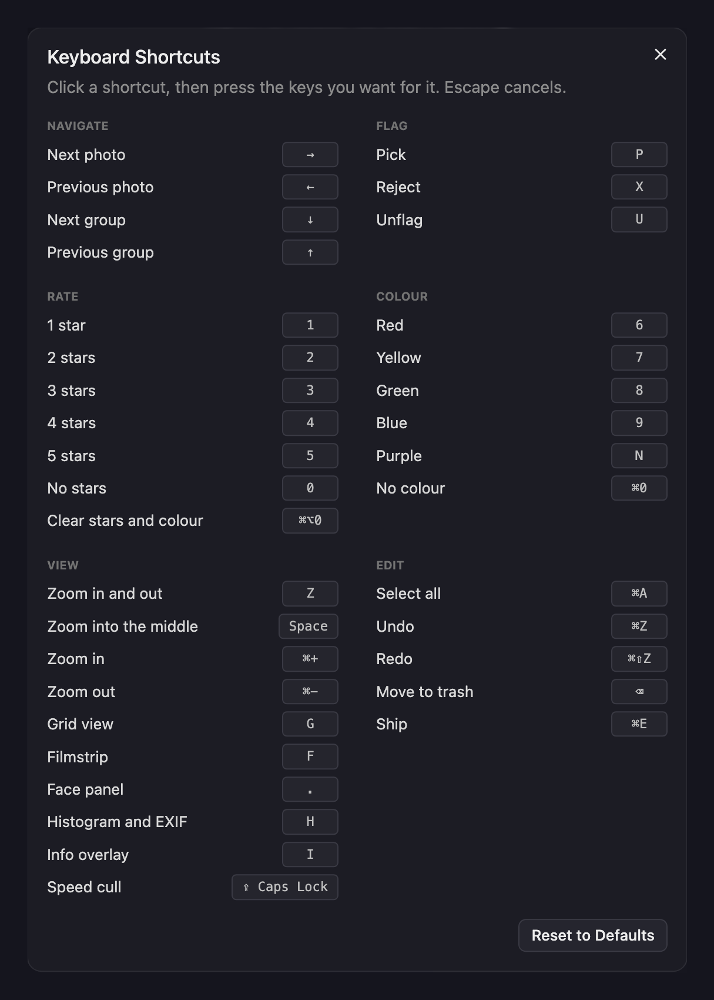

<a id="readme-top"></a>

[![Release][release-shield]][release-url]
[![Build][build-shield]][build-url]
[![Issues][issues-shield]][issues-url]
[![GPL-3.0-or-later][license-shield]][license-url]

<div align="center">
  <a href="https://github.com/NatePhotos/OpenCull">
    
  </a>

  <h1>OpenCull</h1>
  <p>Private, fast photo culling for photographers.</p>
  <p>
    <a href="https://github.com/wispdevon/OpenCull/releases/latest">Download</a> ·
    <a href="#try-this-fork">Run from source</a> ·
    <a href="docs/HOW-IT-WORKS.md">How it works</a> ·
    <a href="https://github.com/NatePhotos/OpenCull">Original project</a>
  </p>
</div>

OpenCull is an offline desktop app for reviewing RAW and JPEG shoots. It opens
camera previews without importing or decoding the RAW files, helps compare
frames, and saves ratings and crops in formats photo editors can read.
Photo analysis stays on your computer. The optional MobileCLIP model is
downloaded only when you request it; photos are never uploaded.

This repository is Wisp's fork of [OpenCull by NatePhotos](https://github.com/NatePhotos/OpenCull).
The combined development version is on `dev`; the upstream releases contain
the original application, not this fork's additions.

<div align="center">
  <a href="docs/images/screenshot.jpg">
    
  </a>
</div>

## Try this fork

### Requirements

- [Rust stable](https://rustup.rs)
- Node.js 22.12+, 24, or 26+ and npm 11 or newer. Node 20, 23 and 25 are
  unsupported. The repository pins Node 22.23.3 and npm 11.21.1.
- [Tauri's platform prerequisites](https://v2.tauri.app/start/prerequisites/)
- A fast JPEG library build: on macOS, install Xcode Command Line Tools and run
  `brew install jpeg-turbo pkgconf`; on Linux and Windows, install CMake and
  NASM (NASM is needed on Intel/AMD).

Clone the fork's `dev` branch and start the desktop app:

```sh
git clone --branch dev --single-branch https://github.com/wispdevon/OpenCull.git
cd OpenCull
nvm install
nvm use
npm install --global npm@11.21.1
npm ci
npm run desktop
```

If Node and npm are already installed, use any versions that meet the
requirements and skip the `nvm` commands. The first run compiles the native
app and may take several minutes. Keep the terminal open; stop the app with
Ctrl+C. Frontend edits reload automatically and Rust edits rebuild the app.

### Desktop commands

- **Run the desktop app:** `npm run desktop`
- **Preview the browser demo:** `npm run dev` — sample data only.
- **Build the app and installers:** `npm run build:desktop`

CUDA is detected automatically on supported Linux x86_64 systems. macOS and
Windows use CPU AI. Rendering and AI acceleration are independent.

<details>
<summary>CUDA and Linux rendering options</summary>

- **Force CUDA AI:** `npm run desktop -- --cuda`
- **Force CPU AI:** `npm run desktop -- --cpu`
- **NVIDIA rendering:** `npm run desktop -- --nvidia`
- **Compatibility rendering:** `npm run desktop -- --compatibility`
- **Software rendering:** `npm run desktop -- --software`
- **Build with CUDA:** `npm run build:desktop -- --cuda`
- **Build without installers:** `npm run build:desktop -- --debug --no-bundle`

CUDA requires an NVIDIA GPU and driver, CUDA 13.x runtime libraries and
compatible cuDNN 9.x. The app falls back to CPU if initialization fails.
See [CUDA setup](docs/CUDA-TRIAL.md) and [benchmarks](docs/CUDA-BENCHMARK.md).

</details>

<details>
<summary>Development server and port 1420</summary>

- The desktop command starts Vite and the native app together.
- An existing OpenCull Vite server on port 1420 is reused.
- Another app using that port produces an error before the native build starts.

</details>

## Features

<details>
<summary>Culling and sessions</summary>

- Review folders or memory cards before choosing which photos to copy.
- Combine card sources and select individual card subfolders.
- Compare RAW/JPEG pairs in filmstrip, grid or stack views.
- Set ratings, flags, colour labels and crops; resume recent sessions.
- Reviewing a card leaves its originals untouched.

</details>

<details>
<summary>Local AI and grouping</summary>

- Compare faces for sharpness, expressions, closed eyes and gaze.
- [Group visually similar photos with MobileCLIP](docs/features/MOBILECLIP_GROUPING.md).
- [Detect motion blur](docs/features/MOTION_BLUR.md), with optional one-star and Reject marking.
- [Reuse cached analysis](docs/features/AI_CACHE.md) across sessions.
- Analysis runs locally; downloading the optional model does not upload photos.

</details>

<details>
<summary>Appearance and workspace</summary>

- Choose Dark, Light, 18% grey or Wisp themes, plus your font and interface scale.
- Select the home layout and optional featured image.
- Resize panels and filmstrips, and choose which panels are visible.
- Enable experimental native-aspect filmstrips, transitions and face overlays.

</details>

<details>
<summary>Shortcuts and saved preferences</summary>

- Customize shortcuts in **Settings → Keyboard**.
- Follow the first-launch overview for common keys and the culling workflow.
- [Import or export settings](docs/features/SETTINGS_TRANSFER.md) without photos or session history.

</details>

- [Feature guides](docs/features/) — options and experimental limitations.
- [How it works](docs/HOW-IT-WORKS.md) — previews, analysis and measured performance.

## Keyboard basics

<details>
<summary>Common keyboard shortcuts</summary>

| Key | Action |
|---|---|
| `←` / `→` | Previous / next photo |
| `↑` / `↓` | Previous / next group |
| `P` / `X` / `U` | Pick / reject / clear flag |
| `1`–`5` / `0` | Set star rating / no stars |
| `Space` | Zoom to a face, then back out |
| `Z` | Zoom to the centre, then back out |
| `G` / `F` | Grid view / toggle filmstrip |
| `H` / `.` | Histogram and EXIF / face panel |
| `Caps Lock` | Toggle speed culling |
| `R` | Crop and straighten |

<div align="center">
  
</div>

</details>

## Built with

[![Tauri][Tauri-badge]][Tauri-url]
[![Rust][Rust-badge]][Rust-url]
[![React][React-badge]][React-url]
[![TypeScript][TypeScript-badge]][TypeScript-url]
[![Tailwind CSS][Tailwind-badge]][Tailwind-url]
[![ONNX Runtime][ONNX-badge]][ONNX-url]

The optional Linux CUDA build also uses [NVIDIA CUDA][CUDA-url] and
[cuDNN][cuDNN-url]. Third-party software and model licenses are listed in
[`THIRD-PARTY-NOTICES.md`](THIRD-PARTY-NOTICES.md).

## Development and checks

Run these from the repository root with the requirements above installed:

```sh
npm run test:web
npm run test:rust
npm run build:web
npm run check
```

`npm run check` runs the frontend and Rust tests plus the frontend production
build. `npm run build:desktop` creates the native app and installer packages.
For a read-only native check against a folder of photos, see
[Checking it works](docs/HOW-IT-WORKS.md#checking-it-works).

Development in this fork happens directly on `dev`; `main` is the release
branch. Earlier work branch tips are preserved as
[archive tags](docs/BRANCH_ARCHIVE.md). Contributions to this fork should
target `dev`. To contribute to the original project, use
[NatePhotos/OpenCull](https://github.com/NatePhotos/OpenCull).

## License and contact

Copyright © 2026 The OpenCull authors. OpenCull is distributed under the
[GNU General Public License, version 3 or later](LICENSE), without warranty.
See [`THIRD-PARTY-NOTICES.md`](THIRD-PARTY-NOTICES.md) for dependencies,
model credits and their licenses.

Original project and maintainer: [NatePhotos](https://github.com/NatePhotos/OpenCull)
· [Instagram](https://www.instagram.com/natephotos.ny) ·
[email](mailto:natephotos.ny@gmail.com). For issues and feature requests in
this fork, use [wispdevon/OpenCull issues][issues-url].

<p align="right"><a href="#readme-top">Back to top</a></p>

[release-shield]: https://img.shields.io/github/v/release/wispdevon/OpenCull?include_prereleases&style=for-the-badge
[release-url]: https://github.com/wispdevon/OpenCull/releases
[build-shield]: https://img.shields.io/github/actions/workflow/status/wispdevon/OpenCull/build.yml?branch=main&style=for-the-badge
[build-url]: https://github.com/wispdevon/OpenCull/actions/workflows/build.yml
[issues-shield]: https://img.shields.io/github/issues/wispdevon/OpenCull.svg?style=for-the-badge
[issues-url]: https://github.com/wispdevon/OpenCull/issues
[license-shield]: https://img.shields.io/badge/license-GPL--3.0--or--later-blue?style=for-the-badge
[license-url]: LICENSE
[Tauri-badge]: https://img.shields.io/badge/Tauri-24C8D8?style=for-the-badge&logo=tauri&logoColor=white
[Tauri-url]: https://tauri.app
[Rust-badge]: https://img.shields.io/badge/Rust-000000?style=for-the-badge&logo=rust&logoColor=white
[Rust-url]: https://www.rust-lang.org
[React-badge]: https://img.shields.io/badge/React-20232A?style=for-the-badge&logo=react&logoColor=61DAFB
[React-url]: https://react.dev
[TypeScript-badge]: https://img.shields.io/badge/TypeScript-3178C6?style=for-the-badge&logo=typescript&logoColor=white
[TypeScript-url]: https://www.typescriptlang.org
[Tailwind-badge]: https://img.shields.io/badge/Tailwind_CSS-06B6D4?style=for-the-badge&logo=tailwindcss&logoColor=white
[Tailwind-url]: https://tailwindcss.com
[ONNX-badge]: https://img.shields.io/badge/ONNX_Runtime-005CED?style=for-the-badge&logo=onnx&logoColor=white
[ONNX-url]: https://onnxruntime.ai
[CUDA-url]: https://developer.nvidia.com/cuda-toolkit
[cuDNN-url]: https://developer.nvidia.com/cudnn
